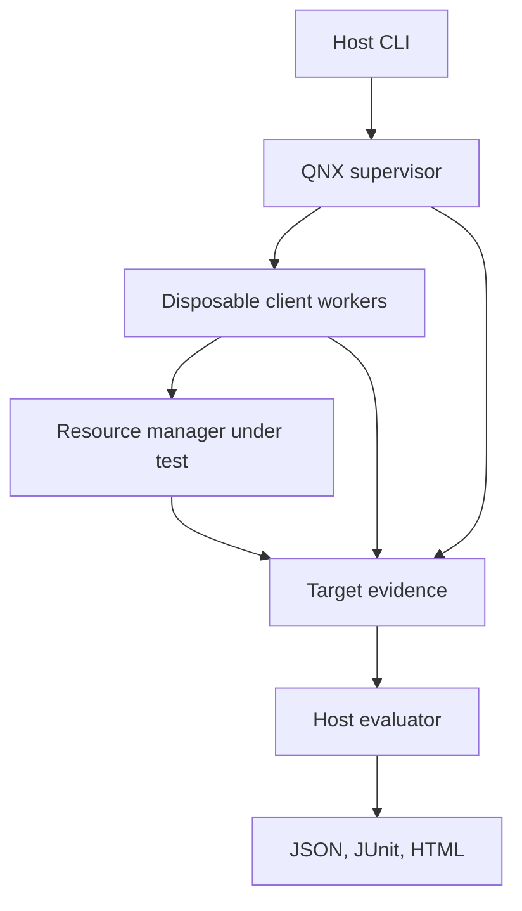

# ResMgrCheck: complete implementation plan in 10 phases

**Implementing agent:** GPT-6.1 Sol, medium reasoning  
**Prepared:** 6 November 2026  
**Hackathon category:** Developer Tooling & Host Tools  
**Submission deadline:** 15 December 2026, 20:00 Europe/Berlin  
**Delivery target:** submission-ready by 11 December, with 12-14 December reserved for authorized publication and corrections  
**Current status:** implementation plan only. No application code, QNX installation, native execution, test result, or performance measurement is claimed by this document.

## Product and completion target

Build **ResMgrCheck**, a developer tool that detects, explains, and replays cancellation and client-lifecycle failures in QNX 8.0 resource managers. A resource manager is a service that exposes an interface such as a device path. This project concentrates on services that keep a request pending while waiting for data or work.

The complete user journey is:

1. Select an explicitly configured QNX lab target and service profile.
2. Verify a normal operation against that service.
3. Exercise timeout cancellation, signal interruption, client termination, and repeated cancellation/reconnection.
4. See which declared obligation passed, failed, or could not be evaluated, with the underlying target observations.
5. Save the case, correct the service, and replay the same inputs against the corrected build.
6. Use a second service through the documented adapter interface without adding service-specific logic to the runner or evaluator.

The project tests declared behavior under recorded conditions. Passing does not establish freedom from defects, a hard real-time bound, safety certification, or production readiness of a tested service. QEMU is sufficient for the planned behavioral demonstration; it does not provide evidence of hardware worst-case execution time.

The hackathon permits relevant host tools and requires meaningful QNX evidence, public open-source source code, build/run instructions, and a public YouTube demonstration under three minutes. Prepare for those requirements throughout development. [S1]

QNX already provides `server-monitor`, which can detect servers that leave unblock requests unresolved and take configured actions. ResMgrCheck's intended contribution is the developer workflow around service profiles, directed test scenarios, post-client state/health assertions, saved evidence, and replay after a change. Describe that specific contribution accurately. Account for an existing monitor when establishing the lab environment, since its actions could alter a test result. [S15]

## Instructions for the implementing agent

Use this document as the execution specification. Work through the ten phases in order. Continue to the next phase after its gate passes; do not ask the user to approve each phase.

Read the repository's applicable instructions before changing files. Preserve existing user work. Create or use a dedicated project directory and branch. Do not overwrite an unrelated repository or weaken existing permissions or instructions.

Keep the following records in the project:

| File | Purpose |
| --- | --- |
| `docs/IMPLEMENTATION_PLAN.md` | This plan, copied into the project as the working specification |
| `docs/STATUS.md` | Current phase, last verified state, blockers, and next executable step |
| `docs/DECISIONS.md` | Short records of material choices, their evidence, and consequences |
| `docs/TEST_EVIDENCE.md` | Actual commands, outcomes, target/build identities, and evidence bundle locations |
| `docs/KNOWN_LIMITATIONS.md` | Supported boundary and unresolved limitations stated precisely |

Before each work session, read `STATUS.md`, inspect the relevant diff, and identify the next incomplete gate. Complete a small coherent change, run the relevant check, and record its actual result. Commit a coherent checkpoint when appropriate. Do not repeatedly run unrelated test suites after a change has been sufficiently verified.

For every phase, record:

- What changed and why.
- Which checks ran on the host and which ran on actual QNX.
- Pass, fail, blocked, or not run, with the corresponding evidence.
- Any deliberately injected fixture defects.
- Remaining uncertainty and the exact next step.

If a gate fails, diagnose the smallest failing path. Do not mark it complete because code exists or because host tests pass. If access, installation, or authentication requires the user, explain the specific local action needed. Never request passwords, tokens, license keys, `.env` contents, or protected configuration in chat. Continue independent work when useful, but leave the dependent gate visibly blocked.

The user selects the agent model and reasoning level. Do not claim to change your own model configuration. This plan deliberately uses explicit interfaces, bounded tasks, and evidence gates to reduce the amount of unstated architectural judgment required at medium reasoning.

## Fixed scope and architecture

### Technology decisions

| Area | Decision for version 1 | Reason |
| --- | --- | --- |
| Target | One installed QNX OS 8.0 build, x86_64, QEMU | Keeps the native evidence reproducible without specialist hardware |
| Development host | Linux, including the documented Ubuntu/WSL2 route when using Windows | One build and automation path; record the actual host version |
| Native implementation | C11 with required QNX extensions, built using `qcc` | Direct access to documented IPC and resource-manager APIs |
| Build | A small Make-based build owned by this project | Avoids a second large build-system integration |
| Host implementation | Python 3.10 or newer, standard library for the application | CLI, validation, evaluation, hashing, XML, and static report generation |
| Native JSON | A pinned, vendored revision of cJSON, with its license | Avoid writing a general JSON parser; compile its source into the project [S12] |
| Target transport | System OpenSSH, one tested SSH/file-transfer path | Reuse local authentication and existing tools |
| Result presentation | A self-contained offline HTML report, plus JSON and JUnit XML | Useful without a server, account, frontend framework, or external assets |
| Contract evaluation | One deterministic evaluator in Python | Avoid inconsistent verdict rules in C, Python, and JavaScript |
| Native responsibilities | Supervision, scenario execution, process ownership, observations, cleanup | Collect facts even when the tested operation stops responding |
| Service integration | A small, versioned native adapter interface | Add service knowledge outside the core runner and evaluator |

QNX publishes a WSL2 setup workflow. Its documentation also describes `qcc` target selection and `mkqnximage` QEMU image creation. These are supported starting points to validate locally, not proof that the user's environment is already configured. [S2, S3, S4]

Use C11 language features and document the exact compiler flags actually tested. Start with the installed x86_64 variant reported by `qcc -V`; `gcc_ntox86_64` is the documented target name. Do not silently substitute a Linux compiler for native builds. [S3]

### Process boundaries



The supervisor must not execute the service operation being tested. Baseline probes, readiness probes, control operations, health probes, and normal client operations can all block. Run service-facing calls in supervised workers. The supervisor handles bounded reads from worker channels, process events, and its own monotonic deadlines.

The host adds an outer process/transport deadline. If the target or supervisor becomes unavailable, preserve the partial evidence and report an infrastructure error. A host timeout does not prove which target component failed, and closing SSH does not prove that remote processes stopped.

### Initial services

**Sensor fixture:** a deferred sample read. A normal read returns a small, documented sample record. In the pending state, the resource manager records the request and returns to its dispatch loop while retaining the request for later completion. It must not block the dispatch thread waiting for the sample.

**Job fixture:** a small service with a project-defined `WAIT_RESULT` device-control operation. A submitted job can outlive a particular waiting client. Cancelling or terminating a waiter removes that waiter's pending request without silently deleting the job. A new client can retrieve the eventual result according to the documented consumption policy.

Use an explicit fixture-only control interface for reset, readiness, releasing data/work, and observing pending requests. These hooks are lab instrumentation, not a simulated QNX transport. The read, device-control request, cancellation, and process lifecycle must execute on real QNX.

Both released fixtures default to corrected behavior. Deliberate defect modes must be named, visible in the report, and enabled explicitly. At minimum, include an ignored unblock request and a retained waiter after client departure. Do not create a dozen artificial defects merely to inflate the test count.

### Adapter boundary

Use a versioned C adapter interface, statically linked into the worker. Registration and adapter sources live outside `native/core/`. The supervisor addresses a registered adapter by ID; profiles cannot name arbitrary shell commands or load executable paths from a downloaded result bundle.

The adapter supplies:

- Its ID, version, supported operation kinds, and observation capabilities.
- Preparation and invocation of one supported pending operation.
- Normal-result decoding into typed facts, including the API's return-value convention.
- Pending-request and service-state observations where the service exposes them.
- A fresh-connection health probe.
- Fixture-specific control operations when using a managed demonstration fixture.

Adapters provide observations, not final pass/fail verdicts. The common evaluator compares typed facts against a small vocabulary of declared expectations: expected return/error, required event, pending count, service health, job identity, and allowed state transitions.

The second adapter may add its source, registration, build entry, profile, and service documentation. It must not require branches such as `if service == jobs` in the supervisor, evaluator, or renderer. If it exposes a missing generic capability, revise the adapter contract once, record the reason, and rerun the first service before calling the interface stable.

Support a managed-fixture mode and an attach-to-service mode. Managed mode owns the fixture process it launches. Attach mode never kills, restarts, or reconfigures an externally managed service without an explicit separately authorized action. Strong cancellation checks require a reliable pending-state observation; report that capability as unavailable when an adapter cannot provide it.

### Repository layout

These are intended paths in the new project, not files already implemented.

| Path | Responsibility |
| --- | --- |
| `README.md`, `LICENSE`, `THIRD_PARTY_NOTICES.md` | Entry point, original-code license, dependency notices |
| `Makefile` | Native build and named validation targets |
| `native/core/` | Scenario state machine, deadlines, evidence protocol, process ownership |
| `native/runner/` | Supervisor executable entry point |
| `native/worker/` | Disposable worker entry point and adapter dispatch |
| `native/adapters/` | Public adapter header, registry, sensor and job adapters |
| `native/fixtures/` | Original sensor/job resource managers and their control protocol |
| `native/spikes/` | Minimal experiments retained only when useful and documented |
| `third_party/cjson/` | Pinned source, license, and revision metadata |
| `resmgrcheck/` | Host Python package, CLI, validation, evaluator, transport, replay, exporters |
| `resmgrcheck/report_assets/` | Local HTML/CSS and small optional JavaScript source |
| `profiles/` | Reviewed service profiles with explicit contracts |
| `suites/` | Named scenario selections and deliberate-defect expectations |
| `config/target.example.json` | Nonsecret target configuration example |
| `tests/host/` | Host logic tests, with synthetic evidence clearly identified |
| `tests/qnx/` | Native integration cases and expected outcomes |
| `docs/` | Setup, architecture, adapter guide, data formats, evidence, codelab, status |
| `docs/submission/` | Demo script, evidence map, submission text, release checklist |
| `build/`, `runs/`, `.local/` | Ignored generated output and local configuration |

Use an open-source license for original project code, with MIT as the default unless the owner specifies otherwise. Preserve third-party license text. Do not commit QNX SDK contents, license material, runtime images, private keys, or machine-specific authenticated configuration. Source-based reproduction is the release approach; redistribution of proprietary QNX components is not assumed.

## Evidence and verdict contract

Define these distinctions before polishing the interface.

| Outcome | Meaning | Example |
| --- | --- | --- |
| `PASS` | All required observations exist and satisfy the declared contract | Cancellation returns as expected, request state clears, fresh client succeeds |
| `FAIL` | Valid evidence demonstrates a contract violation | A confirmed pending request receives cancellation but remains unresolved past the configured limit |
| `ERROR` | The harness, profile, environment, or evidence prevents a valid conclusion | Target unavailable, worker crashes unexpectedly, event stream is incomplete |
| `UNSUPPORTED` | The adapter or target lacks a required capability | Pending-state observation unavailable for a requested strict scenario |
| `NOT_RUN` | A case was not attempted because a prerequisite failed or the run stopped | Later cases withheld after cleanup failed |

Keep run completion separate from case verdicts: `complete`, `incomplete`, or `aborted`. A worker killed by the watchdog is an execution observation. It becomes a contract failure only when the required preconditions and cancellation evidence are available. Missing evidence must not be interpreted as successful cleanup.

Each run must contain:

- Run, case, attempt, cycle, and service-instance IDs.
- Tool and schema versions; source revision and dirty-worktree state.
- Exact profile/suite snapshots and hashes.
- Runner, worker, adapter, and fixture build identities and hashes.
- Actual QNX release, architecture, compiler variant, image recipe identity, and relevant configuration.
- Intended operation, trigger, signal disposition where applicable, declared deadlines, and reset policy.
- Raw client return value, captured error value, and normalized result with its API convention.
- Ordered per-producer events, observation sources, and monotonic timestamps.
- Baseline, pending-state confirmation, trigger observations, post-case health, and cleanup outcome.
- Final verdict, stable reason code, and references to the observations supporting it.

Store nanosecond timestamps and opaque native IDs such as receive IDs as decimal strings in JSON. This avoids precision loss in JSON libraries and JavaScript. Keep bounded millisecond settings as ordinary integers. Target monotonic time and host wall time are separate domains; never subtract one from the other to claim latency.

Relevant producer events carry a target `CLOCK_MONOTONIC` timestamp captured when that producer observes the named transition, plus a per-producer sequence number. Name the observation precisely: an unblock handler's timestamp is when it handled the notification, not an exact kernel timer-expiry timestamp. The supervisor may additionally record receipt time, but file order and receipt order do not establish cross-producer occurrence order. Use explicit causal barriers or valid source-time comparisons for ordering assertions; report ambiguous ordering as unestablished.

Use one supervisor as the authoritative event-file writer. Give producer messages bounded framing and sequence numbers. Broken channels, malformed frames, log overflow, or missing final markers produce visible evidence errors. Never quietly discard events that are required to evaluate a case.

Use a small, versioned field contract and explicit validation functions. Do not build a general-purpose schema engine. Reject unknown versions, duplicate object keys, wrong types, booleans where integers are required, unsafe paths, unreasonable nesting, and out-of-range sizes. Pin cJSON and use case-sensitive lookup; validate after parsing. Do not serialize native QNX structures directly as a portable file format.

Suggested starting limits, to validate during the native spike:

| Setting | Initial value | Purpose |
| --- | ---: | --- |
| Pending/setup deadline | 2,000 ms | Establish the case precondition |
| Kernel operation timeout | 500 ms | Trigger the timeout scenario |
| Cancellation completion allowance | 2,000 ms | Bound the declared cancellation response |
| Health-probe deadline | 2,000 ms | Bound a separate fresh-client probe |
| Case execution deadline | 10,000 ms | Keep the attempt bounded independently of the worker |
| Cleanup deadline | 2,000 ms | Bound cleanup after the execution portion |
| Repeated-cancellation cycles | 20 | Exercise state reuse without an uncontrolled stress test |
| Maximum configured cycles | 200 | Bound user-requested repetition |
| Profile/job input size | 1 MiB | Bound parsing and transfer |
| Event frame size | 16 KiB | Bound individual evidence messages |

These are initial lab settings, not measured guarantees. Give each repeated cycle its own case bound and compute the host run limit from the complete planned sequence plus transfer allowance. If a VM is too slow to establish preconditions, report that fact and calibrate documented defaults. Do not increase limits automatically until a failing service appears to pass.

Define deadline origins explicitly. In the timeout case, cancellation completion is due by the recorded absolute operation deadline plus the cancellation allowance, not a fresh allowance starting when a delayed unblock log arrives. In the signal case, use the observed successful signal-send interval and its configured allowance. Record any uncertainty in that interval. Setup and health-probe deadlines start when their respective supervised operations begin; cleanup has its own bound after execution stops.

## Schedule

The dates are a planning allocation for a start on 6 November, not a claim about the user's available hours. Preserve the sequence if work begins later, and cut optional presentation work first.

| Phase | Suggested window | Primary completion gate |
| --- | --- | --- |
| 1 | 6-8 November | A source-built program runs on the actual QNX target |
| 2 | 9-11 November | One real cancellation defect is detected, bounded, corrected, and rerun |
| 3 | 12-14 November | Versioned contracts and a second-service adapter proof |
| 4 | 15-18 November | Reliable supervision, observations, and bounded cleanup |
| 5 | 19-22 November | Complete native scenario matrix on both services |
| 6 | 23-25 November | Validated evidence, replay, comparison, and JUnit |
| 7 | 26-28 November | Coherent build/deploy/run workflow from the host CLI |
| 8 | 29 November-1 December | Clear offline report generated from real evidence |
| 9 | 2-7 December | Fresh reproduction, targeted hardening, and codelab |
| 10 | 8-14 December | Rehearsed demonstration and reviewable submission package |

All project-specific commands below are interfaces the agent must implement. They do not currently exist merely because this plan names them. Documented QNX commands still require a correctly installed and licensed local environment.

## Phase 1: Establish the workspace and prove QNX execution

**Objective:** remove environment uncertainty before building the testing product.

**Dependencies:** access to the actual development machine, QNX account/license setup performed through the normal local flow, and sufficient local permissions for the chosen VM route.

### Implementation sequence

1. Inspect the current directory, repository status, existing instructions, and available tools without printing protected configuration. Create the dedicated project if it does not exist. Preserve any existing implementation.
2. Create the minimal source/documentation layout, ignore rules, license, and status files. Record the scope in `docs/architecture.md`. Do not scaffold an unused frontend, database, service backend, or CI platform.
3. Inventory host OS, Python, Make, OpenSSH, QEMU, and QNX SDP. Run `qcc -V` in the SDK-enabled shell and record the available variant and compiler version. Load the SDK's actual `qnxsdp-env.sh` location locally; do not guess its path or dump the entire environment.
4. Follow the official QNX route to create an x86_64 QEMU target in an ignored, dedicated image directory. Confirm whether acceleration is available. Use an established fallback when it is not, and record it; do not disable unrelated host security or virtualization features speculatively. [S2, S4]
5. Establish the actual console and file-transfer route. Prefer an SSH alias with locally configured credentials and host-key verification. Verify that the target supports the chosen transfer mechanism. Keep networking limited to the intended lab setup.
6. Write a small original `hello.c`, build it with the QNX cross-compiler, transfer it, execute it on QNX, and capture its output and exit status. Record target identity from the target itself.
7. Confirm availability of the native APIs and facilities needed next: resource-manager headers, dispatch, monotonic clocks, process creation/waiting, pipes or equivalent bounded channels, and the relevant IPC APIs. Inventory any `server-monitor` or other service-management policy that could stop/restart the fixtures. Use a dedicated lab recipe with known behavior; do not disable unrelated system monitoring. An SDK header existing is not evidence that an application executed. [S15]
8. Record every setup step actually needed in `docs/setup-qnx.md`, including missing packages and manual authentication actions. Save the first real build/run evidence.

Useful documented starting commands, to run only in the correctly prepared local directories:

```bash
qcc -V
mkqnximage --type=qemu --arch=x86_64 --build
mkqnximage --run
mkqnximage --getip
```

Use the image command options verified for the installed SDK. Do not use `--wipe` on an existing image as routine troubleshooting. The image, generated runtime, and private SSH material remain local. [S4]

### Deliverables

`README.md`, the foundational status/decision/evidence documents, `native/spikes/hello.c`, a native build target, a tested VM recipe, a nonsecret target configuration example, and a real QNX execution transcript.

### Validation and exit gate

- The recorded binary is demonstrably a QNX x86_64 build and executes on the QNX 8.0 target.
- Its source, build command, toolchain identity, target identity, output, and exit status are linked in the evidence record.
- A second execution works through the documented connection route.
- No native result is inferred from a Linux build or a host-only script.

**Stop condition:** if the environment cannot run the program, leave this gate blocked and identify the precise missing local action. Useful documentation and host parser work may continue, but no dependent native phase is complete.

## Phase 2: Prove the cancellation problem end to end

**Objective:** demonstrate the project's essential value with one tiny resource manager before building general infrastructure.

**Dependencies:** Phase 1 passed.

### Implementation sequence

1. Implement the sensor fixture with a normal sample read, a controlled pending state, and an explicit release action. Start with one dispatch thread and a small bounded pending-request table. Return to dispatch after deferring a request, retaining only correctly owned state.
2. Emit observations for request receipt, pending registration, unblock handling, completion, and cleanup. Assign a logical request ID and generation; do not treat a reusable kernel receive ID as a permanent identity.
3. Implement a minimal independent supervisor that starts the fixture and a disposable client worker, observes progress, and applies an outer deadline. It must not block on the worker's tested call.
4. Verify the normal operation using ordinary client APIs. For the timed operation, use a reviewed native message path with installed QNX headers, such as `_IO_READ` via `MsgSendv()`. Compare its successful behavior with the ordinary read path. Do not invent ABI layouts or assume a libc wrapper preserves timer arming.
5. Arm `TimerTimeout()` for both send and reply blocking immediately before the intended kernel send. Prefer a precomputed absolute `CLOCK_MONOTONIC` deadline with `TIMER_ABSTIME`, so the timer threshold can be compared with source-stamped pending registration without querying the clock after arming. Prepare buffers, clocks, logging, and IPC beforehand. No logging, clock query, allocation path, or other unreviewed call may intervene between successful arming and the send. [S5]
6. Observe that the service actually has the request pending. For a timeout, record the intended absolute deadline before arming, and establish that the service registered the pending request before that deadline and subsequently handled the timeout-related unblock. Do not infer this from supervisor receipt order. A late or ambiguous precondition produces `ERROR: precondition_not_established`. For later signal/exit cases, use the pending observation as the trigger barrier. A sleep is not proof of this state.
7. Add a visibly labeled `ignore-unblock` fixture defect that records receipt of the unblock request but deliberately leaves the application request pending. The supervisor must reach its bound, preserve the case, and take the tested cleanup path.
8. Implement corrected unblock handling. First call `iofunc_unblock_default()` and return its result unless it returns `_RESMGR_DEFAULT`. Then locate the fixture's pending request and use current `MsgInfo()` data to check `_NTO_MI_UNBLOCK_REQ` and request ownership. Resolve it exactly once, release its state once, and ignore unmatched or obsolete unblock notifications with `_RESMGR_NOREPLY`. Use QNX 8.0 types, including `rcvid_t`, where the installed headers require them. [S8, S10, S18]
9. When processing a valid live unblock request, `MsgError(rcvid, -1)` can preserve the kernel's original cancellation error. It is not a generic error-reply value. After a manual terminal reply/error in the handler, return `_RESMGR_NOREPLY` so the library does not reply again. For completion after a handler has already deferred the request, use the documented `MsgReply*()`/`MsgError()` path and owned request state; do not retain a dispatch context and later use a synchronous resource-manager helper as an asynchronous reply API. Verify expected timeout and signal results empirically before freezing profiles. [S9, S18]
10. Rerun the exact case settings against the corrected fixture and use a fresh client to read successfully afterward. Save a minimal reproduction input and both real evidence sets.
11. Investigate cleanup while the client is reply-blocked. Test termination and reaping on the actual target. Do not assume that sending a termination signal guarantees immediate process death. Record the escape path if stopping the owned fixture is required.

### Native facts that must remain explicit

With server-mediated unblocking, an expired client timeout can cause an unblock notification while the client remains waiting for a server reply. The tool therefore needs independent supervision. This is documented QNX behavior, not evidence of a QNX defect. [S5, S6]

The corrected fixture must use the resource-manager library's documented handler/default behavior appropriately. Custom pending-request cleanup is additional application logic; the default handler does not know the fixture's private queue. Preserve default bookkeeping, including the close-handler responsibilities described in Phase 5. [S10, S16]

### Deliverables

Minimal supervisor/worker, sensor fixture with disclosed defective and corrected modes, a native-semantics decision record, actual before/after evidence, and a saved input sequence that can be rerun manually.

### Validation and exit gate

- Normal read succeeds.
- The defective fixture has a confirmed pending request and observed unblock request, then fails the declared cancellation obligation.
- The independent supervisor remains responsive and records the outcome.
- Corrected handling completes with the expected recorded error, clears the pending state, and permits a healthy new client.
- Cleanup behavior, including any limit, is observed rather than assumed.
- The defect can be shown again from the saved settings.

**Stop condition:** if this slice cannot reliably distinguish the planted defect from the correction, fix or reduce the native design before building the broader tool. Do not substitute animations, fabricated logs, or host simulations.

## Phase 3: Define the contracts and prove a second service fits

**Objective:** turn the native slice into a reusable tester and expose integration problems early.

**Dependencies:** Phase 2 passed, including documented timer and cleanup behavior.

### Implementation sequence

1. Write `docs/formats-v1.md` for the profile, expanded scenario plan, producer event, target run manifest, evaluated result, and replay input. Use explicit version fields and bounded types.
2. Implement Python dataclasses or equivalent typed records and explicit validators. Keep input syntax narrow. A profile selects registered operations and declares expectations; it cannot execute arbitrary commands or contain Python expressions.
3. Pin a reviewed cJSON revision, record its exact upstream revision and file hashes, preserve its license, and compile only the needed library sources. Verify it builds with the actual QNX toolchain. Do not fetch a moving branch during every build. [S12]
4. Define `adapter_v1.h`, capability IDs, typed operation results, and the small worker command protocol. Keep service-specific parsing in adapter files. Keep process/deadline logic in the core.
5. Adapt the sensor implementation to that interface without changing its demonstrated behavior.
6. Implement the minimal job fixture with a valid submit/complete path and deferred `WAIT_RESULT`. Use a small fixed-capacity queue and explicit job/waiter ownership. Cancelling a wait must not implicitly remove the job unless the contract explicitly says so.
7. Implement the job adapter. For a timed request, use an explicit, reviewed `_IO_DEVCTL` send path with actual QNX headers, and verify successful equivalence with ordinary `devctl()`. Record native return conventions correctly: a `devctl()` error result must not be read as though every API returned `-1` and set `errno`. [S11]
8. Add its profile and registration outside core files. Demonstrate normal completion, one cancellation path, and retrieval through a new client.
9. Implement the first shared evaluator rules from the observed slice: baseline validity, pending precondition, cancellation completion, pending-state cleanup, fresh-client health, and evidence completeness.
10. Record required versus optional capabilities. A service without a reliable pending observer cannot pass the strict deferred-cancellation scenario merely because an operation took a long time.

### Required profile fields

| Field group | Required content |
| --- | --- |
| Identity | Schema version, profile ID/version, adapter ID/ABI |
| Service | Managed fixture or external attach mode, device path, operation ID |
| Operation | Bounded request parameters, result shape, result/error convention |
| Capabilities | Pending observation, unblock observation if required, state probe, signal mode |
| Expectations | Allowed return/error, cleanup obligations, health predicate, service-specific typed facts |
| Timing | Setup, operation, cancellation allowance, probe, execution, and cleanup bounds |
| Suite | Required scenarios, optional scenarios, cycle count, reset policy |

Do not let the same configuration silently choose both a planted defect and a relaxed expectation that declares that defect correct. The defect fixture option is separate from the expected corrected-service contract. Harness regression tests may expect the tool to report a failure, but the individual report must still show that service failure.

### Deliverables

The versioned data contract, validators, public adapter header, sensor/job adapters, two original fixtures, corresponding profiles, and a short integration guide.

### Validation and exit gate

- Both services run through the same generic native execution path.
- The job service's baseline and cancellation/next-client behavior are recorded on QNX.
- Core runner and evaluator files contain no service-name conditions.
- Invalid profiles are rejected before executing target tests.
- Missing capabilities produce `UNSUPPORTED`, never a fabricated pass.
- The initial adapter guide explains every service-specific addition made.

**Stop condition:** if the second service needs substantial core modification, resolve the abstraction now. Do not defer the integration proof until after the UI is complete.

## Phase 4: Make supervision and cleanup dependable

**Objective:** promote the working slice into a runner that remains useful when a worker, fixture, observation channel, or transport misbehaves.

**Dependencies:** Phase 3 contracts and both adapter prototypes.

### Implementation sequence

1. Implement the common state machine: validate configuration, establish service identity/readiness, run baseline, start the pending operation, verify its precondition, apply the scenario trigger, observe completion, run the independent health probe, clean up, and finalize evidence. Every wait has an explicit owner and bound.
2. Separate the operation timer, cancellation completion allowance, case execution deadline, cleanup deadline, and host run deadline. The operation timer is part of the tested behavior; the supervisor deadlines are containment mechanisms.
3. Make the supervisor the parent of disposable workers where practical. Track exact child PIDs, process creation results, intended roles, and exit/reap status. Preserve child status collection: do not configure `SIGCHLD` as ignored or use `SA_NOCLDWAIT` when the harness requires wait/reap evidence. Stop signalling a child once it is reaped, and do not trust stale PID files as proof of ownership after a restart. Never clean up by broad process-name matching or by killing every QNX test process on the machine. [S13]
4. Implement bounded worker communication with nonblocking reads, explicit framing, size limits, source IDs, and sequence numbers. Keep structured events separate from ordinary stdout/stderr text. A crash message is not an authoritative scenario event.
5. Keep service-facing readiness, control, state, and health calls in separate supervised workers. A stuck diagnostic call must not stall the supervisor that is trying to diagnose the case.
6. Implement the cleanup sequence proven in Phase 2. Request ordinary worker termination when meaningful, escalate only for owned processes, and observe reaping with a bounded wait. If the owned fixture must stop to release a stuck request, record that intervention explicitly.
7. Probe post-scenario service health before an emergency fixture restart whenever the scenario permits it. A probe after restarting the service is a recovery observation and cannot satisfy a requirement that the original instance stayed usable.
8. If cleanup fails, stop subsequent cases that could inherit contaminated state. Write `NOT_RUN` for them, preserve the unresolved PIDs and last observations, and report the run as incomplete or erroneous. Do not continue producing apparently independent results on an unknown state.
9. Handle interrupted host commands. The native run still needs its own deadline if the SSH connection disappears. On reconnection, inspect the specific run ID and collect its status; do not blindly start a duplicate run after an uncertain transport result.
10. Record logging errors, full storage, unavailable event sinks, malformed events, and log truncation. Avoid blocking the tested service on evidence output. If required events are lost, invalidate the relevant conclusion instead of quietly omitting them.
11. Use modest scheduling settings and no busy-spin watchdog. Record scheduling policy and any explicit priority choices. Do not assume that assigning a high nominal priority proves scheduling isolation or a hard completion bound.

If an existing `server-monitor` or another manager signals/restarts the fixture, record that intervention separately and invalidate any assertion whose conditions it changed. Its action is not successful fixture cleanup. The native supervisor's bound is a bound on its planned wait/escalation sequence, not a promise that an unresponsive target will actually reap every child. [S15]

### Failure classification rules

| Observation | Classification rule |
| --- | --- |
| Target cannot be reached | `ERROR: target_unreachable`; no scenario pass |
| Worker cannot start | `ERROR: worker_start_failed` |
| Pending state never established | `ERROR: precondition_not_established`, unless a separately supported black-box contract applies |
| Confirmed pending request and valid cancellation trigger, completion absent past its limit | `FAIL: cancellation_not_completed` |
| Worker dies unexpectedly | `ERROR: worker_crashed`, with actual exit/signal evidence |
| Worker death was the declared scenario trigger and is observed | Expected execution observation; still require the service's post-departure obligations |
| Required event sequence is truncated or malformed | `ERROR: evidence_incomplete` or `evidence_invalid` |
| Service explicitly returns an outcome forbidden by a valid contract | `FAIL: unexpected_operation_result` |
| Pending-request state demonstrably remains when it must be clear | `FAIL: pending_state_not_released` |
| Cleanup cannot restore a known state | Record cleanup error, stop dependent cases, and preserve any already established contract failure |

Do not force a single reason to erase another. A case can have a demonstrated service violation and a later cleanup error. Store both the assertion outcome and execution/cleanup facts; the run's nonzero exit status must reflect that evaluation or completion was compromised.

### Deliverables

Production runner state machine, process ownership module, deadline handling, framed event channel, cleanup policy, recovery/status collection, and reason-code documentation.

### Validation and exit gate

Run focused QNX checks for a normal worker, a stuck worker, an unexpected crash, an unavailable service, a blocked probe, a malformed producer event, a lost connection, and cleanup failure. Use test harness controls only where required to produce the condition. Each check must prove its particular classification and bounded behavior.

The supervisor must remain independent of the tested operation. No unresolved case may be reported as passed. A stalled entire VM may still defeat target-side progress; the host must end with an honest infrastructure result and preserve what it has, rather than claiming successful remote cleanup.

## Phase 5: Complete the native scenario suite

**Objective:** implement all supported scenario families on both services, with positive and deliberate negative controls.

**Dependencies:** Phase 4 supervision and evidence collection passed.

### Scenario A: Normal operation and fresh-client baseline

Establish service identity, open a fresh connection, issue a valid operation, release data/work through the documented fixture mechanism, validate the result, and close cleanly. Run a separate fresh-client probe. A later cancellation result is not meaningful if the baseline or profile is already invalid.

For jobs, record the job ID and result identity. For the sensor, verify the documented sample shape and value source. These are controlled fixture data generated by actual target execution, not invented results inserted into reports.

### Scenario B: Timeout cancellation

Prepare the exact request and timeout settings before arming. Use the native timed send path validated in Phase 2. Record pending-state confirmation and the relevant cancellation observation. Verify the declared operation error, pending-request cleanup, and independent service health within the configured bounds.

The fixed fixture should preserve the appropriate timeout reason through its valid unblock handling. Do not accept an unrelated error merely because it also ended the request. A case in which the service completed normally before the intended cancellation was exercised does not establish a successful cancellation check; classify the precondition/stimulus mismatch explicitly.

### Scenario C: Signal interruption

Version 1 supports one explicit mode: a dedicated single-threaded operation worker, a recorded `SIGUSR1` handler, no application retry of the interrupted call, and a fixture that aborts rather than replying with `ERESTART`. Configure the handler and mask using the installed QNX 8.0 headers and documented flags, initially `sa_flags = 0`. Do not assume Linux `SA_RESTART` behavior or add a fabricated compatibility definition. Use a minimal signal handler that only updates a `volatile sig_atomic_t` flag. Do not log, allocate, parse JSON, or manipulate pending-request structures inside it. [S9, S13]

Wait for the service's pending observation before signalling the exact owned worker. Record the signal-send result separately from handler execution. In the server-mediated unblock path, a pending signal may not run its handler until the server releases the client, so an absent handler observation is not by itself a root-cause diagnosis. [S7]

Do not arm the scenario's kernel timeout simultaneously and then guess which trigger caused completion. The independent supervisor bound still applies. Verify the signal/error behavior on the installed target. A profile requesting automatic-restart semantics is `UNSUPPORTED` in version 1 unless that mode has been separately implemented and tested. [S9, S13]

### Scenario D: Client termination while pending

Confirm the pending state, apply the declared termination mechanism to the owned worker, and observe process exit/reaping. Use a recorded forced-termination case for the initial abrupt-departure test. If the target does not produce the expected process observation within the bound, report that limitation rather than treating the request to kill as proof of death.

The service must release the departed client's pending request according to its contract. An OCB is the resource manager's open-control state. Distinguish descriptor-close handling (`close_dup`) from final OCB destruction (`close_ocb`), since descriptors can share an OCB. Preserve `iofunc_close_dup_default()` bookkeeping while cleaning up applicable deferred operations. A disconnect can produce a synthetic `_IO_CLOSE` with `ctp->rcvid == 0`; never reply to that synthetic message. The framework does not automatically lock the OCB for `close_dup`, so any multi-threaded extension needs explicit serialization. [S16]

Give each pending request one terminal owner and retain its storage until every path that could reference it has finished. Do not use an OCB after its final close/free path. Verify callback ordering on the actual target. Do not add raw-channel `ConnectDetach(scoid)` cleanup on top of work already performed by the resource-manager library. `_NTO_CHF_THREAD_DEATH` concerns threads of the channel-owning process; use observed worker exit/reap status for the client-departure test. [S7, S17]

After departure, use a new client with a new connection. For the job fixture, show that the job remains available as specified and is not accidentally discarded with the waiter. Do not restart the service before claiming it survived the departure.

### Scenario E: Repeated cancellation and reconnect

Run 20 timeout-cancellation cycles by default against the same service instance, creating a new client connection each cycle. Record cycle IDs and each cycle's precondition, cancellation, state, health, and cleanup observations. Do not reset the service between cycles, since that would hide accumulating state.

A top-level suite can reset the fixture between independent scenario families. Record that policy separately from the no-reset repetition. Stop the repeated sequence if a cycle leaves unknown state; identify later cycles as not run.

For the sensor, verify the declared pending-request count returns to its expected value. For jobs, distinguish pending waiters from retained jobs; a legitimate queued job is not a leaked waiter. Repeated successful reconnects do not establish absence of memory leaks unless an actual memory measurement has been added and described.

### Required ordering checks

Use controlled fixture barriers to cover completion before cancellation and cancellation before completion. The corrected implementation must not double-reply or deliver a stale result to a subsequent request. Use current message information and request ownership when handling queued unblock events, not a cached receive ID alone. [S8]

These are two directed ordering checks, not a new randomized scheduler or general fuzzing framework. Record the order actually observed. Do not claim exhaustive concurrency coverage.

### Deliverables

Reviewed profiles and suites, all scenario implementations, fixture defect switches, meaningful native regression cases, and an explicit supported-scenario matrix.

### Validation and exit gate

| Check | Corrected fixture | Deliberately defective fixture |
| --- | --- | --- |
| Normal operation | Valid actual response and healthy fresh client | Baseline still works for lifecycle-only defects |
| Timeout cancellation | Expected result, released state, healthy service | Ignored unblock is detected for its specific obligation |
| Signal interruption | Recorded non-restart behavior and recovery | Corresponding ignored/unresolved cancellation is detected |
| Client departure | Observed termination, released waiter, healthy next client | Retained waiter or lost-job defect is detected |
| Repetition | Every attempted cycle evaluated; state remains within contract | Accumulating retained state is exposed without hiding earlier failures |
| Completion/cancel ordering | No stale reply or duplicate completion | A targeted negative control, if used, is clearly identified |

Run the applicable matrix on both services. Any deliberately limited capability must be explicit; do not silently mark a required check optional to obtain a green release. At this gate, the core product must be demonstrable from the terminal without the HTML interface.

## Phase 6: Finish evidence, replay, comparison, and test exports

**Objective:** make a detected failure a durable engineering artifact that can be inspected and rerun after a change.

**Dependencies:** Phase 5 native results and stable event meanings.

### Implementation sequence

1. Finalize the run bundle: immutable raw observations, source/profile/build manifests, expanded scenario plan, evaluated results, replay input, and human-readable notes. Generated JUnit and HTML are derived views of this evidence.
2. Write results atomically where supported: create a temporary output, finish validation, then replace the intended final file. Preserve a separate partial-run artifact if execution ends early. Absence of a final marker cannot mean success.
3. Implement the one canonical evaluator. Each assertion returns a verdict, reason code, expected value, observed value, and supporting event references. Make prerequisite failures explicit. Do not infer private service state that no adapter observed.
4. Define a replay artifact containing the exact profile, operation inputs, scenario order, trigger settings, reset policy, timing bounds, and original identities. It contains no executable shell fragments, credentials, live PIDs, or receive IDs to reuse as commands.
5. Implement replay against the same build, then comparison against a deliberately selected candidate build. Provide `--candidate-manifest PATH`, selecting a deployed build by its immutable build ID. Resolve its actual target executables and verify their hashes against that manifest before launch. A fix naturally changes the service hash. Record that difference rather than refusing every post-fix replay or silently pretending the binaries are identical.
6. Reject incompatible schema/adapter versions and mismatched target architectures. If the user explicitly selects a changed candidate build, retain the original and candidate identities in the comparison. A changed expectation/profile is a different test contract and must be highlighted.
7. Record attempt count and preserve all attempts. No automatic rerun-until-pass. Replaying the same inputs does not guarantee an identical scheduler interleaving; display non-reproduction honestly.
8. Implement JUnit XML using a proper XML serializer, with stable suite/case names and references to the bundle. Add a synthetic suite-level error when required cases could not run, so an all-skipped required suite cannot be mistaken for a successful validation.
9. Implement comparison based on case identity and contract, with separate labels for fixed, still failing, newly failing, unsupported, incomparable, and incomplete. Never describe an incomplete candidate run as a fixed defect.
10. Hash the evidence and build artifacts using standard tooling. Hashes provide identity/integrity checks, not an attestation that every reported event is trustworthy against a malicious target.

### Export and exit-code rules

| Internal outcome | JUnit representation |
| --- | --- |
| `PASS` | Test case with no failure/error child |
| `FAIL` | `<failure>` with the specific violated obligation |
| `ERROR` | `<error>` with execution/evidence reason |
| Optional `UNSUPPORTED` | `<skipped>` with capability explanation |
| Required `UNSUPPORTED` or required `NOT_RUN` | Skipped case plus suite-level error explaining incomplete required coverage |

Use these CLI test-execution exit codes:

| Code | Meaning |
| --- | --- |
| `0` | Complete run, all required cases passed, no evaluation/execution errors |
| `1` | Valid completed evaluation includes a contract failure |
| `2` | Invalid input, environment, harness, evidence, or cleanup error |
| `3` | Required coverage unavailable or no qualifying cases executed |
| `130` | User interruption |

Apply precedence `130`, then `2`, then `3`, then `1`, then `0`; retain every case outcome in the result. Offline `report` or `inspect` commands may return zero when they successfully process a valid failed run. Their command success does not change the recorded test verdict.

The harness regression command evaluates whether the checker correctly detects planted defects. It may succeed while individual deliberately defective service runs correctly remain `FAIL`. Document this distinction so the demonstration does not disguise red service results as green application behavior.

### Deliverables

Final versioned evidence/replay formats, evaluator, JSON validation, JUnit exporter, comparison logic, exit-code specification, and real before/after replay bundles.

### Validation and exit gate

- Replay the saved sensor failure against its defective build and then a rebuilt corrected fixture whose binary hash actually differs. Require explicit candidate-manifest selection and preserve the source revisions and changed hashes. The source change must correct the demonstrated behavior, not merely change a build stamp or comment. Keep the same operation inputs, fixture settings, and expected contract. Switching a defect flag within one binary is a useful control, but does not satisfy this changed-build gate.
- Perform an equivalent replay for the second service.
- Validate that changed profiles, incompatible versions, truncated files, duplicate keys, missing events, and unsupported required cases cannot become successful runs.
- Generate JUnit from a mixed-result bundle and inspect its parsed structure.
- Confirm that raw evidence stays unchanged when regenerating derived reports.
- Clearly label host unit-test data as synthetic and the recorded integration bundles as actual QNX executions.

## Phase 7: Complete the host workflow

**Objective:** let a developer use the tool from a clear sequence of commands without undocumented setup or manual reconstruction of target state.

**Dependencies:** Phase 6 data contract and evaluator. A minimal host launcher already exists from earlier phases; this phase finishes the user workflow.

### Required command interface

Run these from the repository root after implementation. `lab` is a local target configuration name established during setup, not a credential or a hardcoded destination.

```bash
python3 -m resmgrcheck doctor --target lab
python3 -m resmgrcheck validate profiles/sensor.json
make qnx QNX_VARIANT=gcc_ntox86_64
python3 -m resmgrcheck deploy --target lab --build build/qnx-x86_64
python3 -m resmgrcheck run --target lab --profile profiles/sensor.json --suite lifecycle --fixture-mode fixed --out runs/sensor-fixed
python3 -m resmgrcheck run --target lab --profile profiles/sensor.json --suite lifecycle --fixture-mode ignore-unblock --out runs/sensor-broken
python3 -m resmgrcheck replay runs/sensor-broken/replay.json --target lab --fixture-mode fixed --out runs/sensor-replay
python3 -m resmgrcheck compare runs/sensor-broken runs/sensor-replay --out runs/comparison
python3 -m resmgrcheck report runs/sensor-replay --out runs/sensor-replay/report.html
python3 -m resmgrcheck verify --target lab --suite release
```

The intentionally broken `run` command must exit nonzero for the detected service defect. Do not write shell examples that rely on every demonstration command succeeding. The replay above illustrates changing the disclosed fixture mode within the same build.

The separate source-correction proof starts with a recorded `runs/source-before` failure from the documented before-fix source revision. Apply the actual handler correction without changing the saved contract or fixture settings, then execute:

```bash
make qnx QNX_VARIANT=gcc_ntox86_64
python3 -m resmgrcheck deploy --target lab --build build/qnx-x86_64
python3 -m resmgrcheck replay runs/source-before/replay.json --target lab --candidate-manifest build/qnx-x86_64/manifest.json --out runs/source-after
python3 -m resmgrcheck compare runs/source-before runs/source-after --out runs/source-comparison
```

`manifest.json` must describe the newly built and deployed candidate. Keep the earlier deployed bundle under its immutable build ID. For an external service, the adapter must identify the actual running candidate build through its supported identity mechanism, or report that changed-build verification is unavailable.

### Implementation sequence

1. Finish `argparse` command handling, concise help, field-specific validation errors, and actionable prerequisite checks.
2. Make `doctor` distinguish host readiness, SDK availability, target reachability, architecture/version compatibility, transfer support, and required capabilities. Report unknown items as unknown. Checking tool versions must not dump secrets or the whole environment.
3. Implement one deployment path using the configured SSH alias and tested file-transfer tool. Preserve host-key checking. Use argument arrays on the host and correctly quote the small fixed remote command surface; `shell=False` locally does not by itself eliminate remote-shell interpolation risks.
4. Use a dedicated remote run directory derived from a strict run-ID grammar. Verify destination ownership and expected manifests before replacing or deleting project files. Never interpolate an arbitrary service profile into a remote command.
5. Stage complete builds and check transferred identities before launch. Record which exact bundle the supervisor ran. Do not claim that a transfer succeeded solely because the local file exists.
6. Implement `run`, `status`, and `collect` so a disconnected session can recover its existing run by ID. Treat an uncertain launch result as uncertain; do not automatically create another run.
7. Make the CLI show baseline status, current case, elapsed time, and the final result location. Keep the default concise and provide detailed diagnostics through an explicit verbose option or files.
8. Support external-service attachment with explicit profile/path selection. Default demonstration commands operate only on project-owned fixtures. Explain required instrumentation and capabilities in `docs/adapters.md`.
9. Finish `verify --suite release` as the harness's expected-outcome matrix. It checks both corrected fixtures and planted defects without changing the underlying case verdicts.
10. Add host-only CI if a repository CI environment is available. It can check Python logic, exports, and portable utilities. Native QNX integration remains a separate required release gate; a hosted Linux badge cannot imply it ran.

### Deliverables

A usable CLI, tested deployment/collection path, target configuration examples, exact quickstart commands, expected-outcome release verification, and concise error messages.

### Validation and exit gate

From a clean shell with the documented SDK environment loaded, perform `doctor`, validation, build, deploy, run, replay, compare, and offline report generation. Repeat with a missing target, invalid profile, wrong architecture, occupied output directory, and interrupted transport. Each must produce the documented result without overwriting unrelated data.

The quickstart must identify every actual manual prerequisite. If the user must authenticate locally or start a VM, say so plainly; do not present those steps as automatically handled by a command that does not implement them.

## Phase 8: Build the offline report and finish the product experience

**Objective:** let a developer understand a failure and its reproduction without reading the entire raw event stream.

**Dependencies:** stable evaluated results and the Phase 7 CLI.

### Report structure

1. **Run summary:** service, target, build, fixture mode, run completion state, required coverage, and case counts.
2. **Case list:** scenario, cycle/attempt, verdict, reason, elapsed time, and whether the necessary preconditions were observed.
3. **Selected case:** declared obligation beside actual observations, with exact error/result values and source event references.
4. **Timeline:** pending request, trigger, operation result or supervisor limit, state probe, fresh-client probe, and cleanup. Show only events that actually occurred; mark missing required observations explicitly.
5. **Replay:** the saved case location, command, original build identity, and candidate-build differences when present.
6. **Evidence:** raw artifact links, version information, and disclosure of fixture instrumentation and deliberate defects.

### Implementation sequence

1. Render a self-contained HTML document using the Python standard library, embedded local CSS, and minimal optional JavaScript for filtering and disclosure controls. Do not create a server, authentication layer, frontend package ecosystem, or cloud account.
2. Use the evaluator's saved outcomes as the source of truth. JavaScript may change presentation, not independently recalculate pass/fail rules.
3. Make the core report usable without JavaScript. Use semantic headings, real table headers, keyboard-accessible controls, clear focus states, and status text in addition to color.
4. Escape every service name, path, log message, and JSON-derived string. Do not insert untrusted text using `innerHTML`. If embedding JSON, handle closing script sequences safely; preferably render the required display text on the host and avoid embedding raw JSON unnecessarily.
5. Show incomplete and unsupported states prominently. An empty run must not show a green summary. A fresh-client probe after a restart must be labeled as recovery after restart.
6. Include a comparison view that separates the changed service build from a changed contract or target. Explain incomparable cases instead of presenting a misleading red-to-green transition.
7. Generate the normal demonstration reports from the actual recorded QNX bundles. Use clearly labeled synthetic bundles only for testing formatting edge cases.
8. Inspect the rendered output in a browser at ordinary laptop width and a narrow window. Test long errors, many cycles, no results, failed baseline, cleanup failure, and missing optional observations. Verify there are no external network requests.

### Deliverables

Offline HTML renderer, local assets, usable case/detail/comparison views, representative real reports, and report-focused regression checks.

### Validation and exit gate

A reader can answer: what was tested, what was expected, what happened, why this verdict follows, whether the service remained usable, and how to rerun the case. All six answers must come from the report and its evidence links. The same report opens offline and preserves the JSON/JUnit verdicts.

If time is short, keep the case table, expectation/observation detail, replay instructions, and evidence links. Remove elaborate visual timelines or comparison animations first.

## Phase 9: Reproduce, harden, and document the release candidate

**Objective:** establish that the documented project can be built and evaluated from its public source without relying on hidden local state.

**Dependencies:** the complete CLI, native suite, replay, and report workflow.

### Implementation sequence

1. Freeze feature scope. Record the candidate revision and run the expected-outcome release suite. Fix concrete correctness, reproducibility, and documentation defects; postpone speculative refactoring.
2. Build from a clean checkout in a separate directory using the documented licensed SDK. Recreate a fresh target from the recorded recipe, or document exactly which target state is reused. Never call a reused personal setup a fresh reproduction.
3. Follow the README literally: prerequisites, SDK shell, target creation/start, authentication, profile validation, build, deploy, corrected run, deliberately defective run, replay, report. Add every missing step discovered.
4. Review native ownership: pending entries, OCB references, current receive IDs, manual versus library replies, file descriptors, child processes, job/waiter lifetimes, and error paths. Verify resource-manager bookkeeping against the official API documentation rather than adapting an old sample blindly.
5. Review profile and native input limits, message lengths, control-operation access, and return-value handling. Validate custom device-control payload sizes explicitly. The fixture control interface must be restricted to the intended lab use. These checks protect the tool's own implementation; they are not a new security-auditing product claim. [S14]
6. Review evidence integrity paths: log overflow, incomplete run, unknown schema, duplicate keys, unexpected producer death, clock-domain confusion, and candidate-build mismatch. Test only the remaining concrete risks and required gates.
7. Review host paths and report rendering for traversal, command interpolation, executable content, unexpected overwrite, and unsafe remote cleanup. Do not make a replay bundle executable code.
8. Use compiler warnings and applicable analysis tools on owned code. Use host sanitizers only for genuinely portable components when useful; they do not validate QNX IPC semantics. Record any target tooling that is unavailable rather than claiming it ran.
9. Complete `docs/adapters.md` using the second service as the worked integration example. List the exact adapter/build/profile changes and the unchanged core boundary. If another developer or isolated review agent follows the guide, record who or what performed that review accurately. An AI review is not external user validation.
10. Write a codelab from the working sensor example: understand the contract, run the normal case, expose the intentional cancellation defect, inspect evidence, apply the correction, replay, and verify the next client. Use exact current filenames/functions and real output captured from the release candidate.
11. Complete the dependency inventory, license notices, supported-environment statement, limitations, and release verification commands. Keep proprietary SDK/runtime inputs out of the source release.
12. Save a final real QNX evidence bundle, host validation results, and the source revision that produced them. Remove accidental secrets and irrelevant local identifiers from publishable copies while preserving the originals privately and recording any redactions.

### Required validation matrix

| Layer | Evidence required | What it does not establish |
| --- | --- | --- |
| Host logic | Validator, evaluator, replay, XML, and report checks | Native cancellation behavior |
| QNX integration | Both services, every supported scenario, fixed and negative controls | Exhaustive concurrency or security coverage |
| Cleanup | Observed owned-process cleanup and contamination handling | Recovery from every possible VM/kernel failure |
| Reproduction | Clean source build and documented target run | Universal compatibility with all hosts and QNX images |
| Adapter reuse | Second service integrated through the public boundary | Adoption by an external developer unless actually tested |
| Product experience | Rendered report inspected and quickstart exercised | A production deployment claim |

### Deliverables

Release candidate, clean reproduction log, final validation matrix, codelab, adapter guide, known limitations, dependency/license inventory, and publishable evidence copies.

### Validation and exit gate

The clean reproduction produces the expected baseline, deliberate failure, corrected replay, JSON, JUnit, and offline HTML. The second service runs through its documented adapter. All required cases have actual QNX evidence. Remaining limitations are specific and visible.

**Stop condition:** if a mandatory technical claim cannot be reproduced, remove or narrow that claim and fix the relevant gate. A documentation disclaimer cannot turn an unimplemented core requirement into a completed one.

## Phase 10: Prepare the demonstration and submission package

**Objective:** deliver a concrete, internally consistent entry that the user can review and authorize for publication/submission.

**Dependencies:** Phase 9 release candidate and reproducibility evidence.

### Implementation sequence

1. Prepare the public repository content: complete original source, top-level license, third-party notices, verified README, target recipe, exact build/run instructions, adapter guide, codelab, limitations, and selected evidence.
2. Create `docs/submission/qnx-evidence-map.md`. Map each claimed capability to real source files/functions, QNX APIs, build artifacts or settings, and a recorded demonstration step. Do not cite QNX merely because its name appears in a README.
3. Write the submission description around the concrete problem, developer workflow, implementation, two-service integration, evidence, and limits. Select Developer Tooling & Host Tools. Mention bonus eligibility only where the actual deliverables justify it.
4. Write and rehearse a video script targeting 2 minutes 45 seconds to 2 minutes 55 seconds. Leave a margin below the three-minute limit. Show the real QNX target and a real run, with readable text and an explicitly labeled intentional defect. [S1]
5. Capture or prepare the actual recording using available local tools. If the agent cannot record the target UI, deliver the exact commands, shots, and narration for the user, and mark recording as a remaining manual action. A storyboard is not a completed video.
6. Verify that the video, screenshots, README, codelab, and submission text describe the same release candidate. Do not show a corrected report next to source that still contains the defective mode as its default.
7. Prepare the repository description, tags, release notes, demo metadata, and final checklist. Public URLs remain pending until they really exist; never invent them.
8. Recheck the current official submission fields and rules before submitting. Prepare the complete reviewable package before requesting any still-needed publication authorization. If publication/submission is already explicitly authorized in the active session, complete it within that authorization. Otherwise report the concrete remaining actions without publishing autonomously.
9. After authorized publication, verify public repository access, license detection, working links, and public video visibility. Submit before the deadline and preserve the actual confirmation. Do not report submission success without observing it.
10. Keep 12-14 December available for link fixes, visibility issues, and submission corrections. The deadline is not the target time for a first upload.

### Demonstration sequence

| Time | What the viewer sees | Claim supported |
| --- | --- | --- |
| 0:00-0:20 | Actual QNX target and a normal sensor read | The native system runs |
| 0:20-0:55 | Explicitly defective fixture, pending request, cancellation, bounded failure | The tool detects a real lifecycle obligation failure |
| 0:55-1:20 | Expected versus observed behavior and the saved reproduction | The failure is understandable and actionable |
| 1:20-1:55 | Relevant handler correction and replay against the corrected build | The same contract distinguishes the correction |
| 1:55-2:20 | Client departure and a successful new-client interaction | Service lifecycle behavior is checked beyond a return code |
| 2:20-2:45 | Job-service adapter using the same runner, evidence and source locations | Integration is not hardcoded to one sample |
| 2:45-2:55 | Build/run entry point and codelab | Another developer has a reproduction path |

No copyrighted music is needed. Avoid unrelated trademarks or other third-party media without permission. The deliberate fixture defect is a test of this harness; do not present it as a discovered vulnerability in QNX or a third-party product. [S1]

### Deliverables

Complete source release candidate; submission text; QNX evidence map; codelab; actual video or clearly identified recording handoff; selected screenshots/reports; release notes; and a final status document with remaining authorized/manual actions.

### Validation and exit gate

Use separate statuses:

- **Engineering complete:** all required implementation and real QNX gates passed.
- **Submission-ready:** the actual required assets exist and have been checked.
- **Published:** the repository/video are actually public and verified.
- **Submitted:** the hackathon confirmation has been observed.

Do not collapse those into one claim of completion. This planning request authorizes preparation of the plan, not publication or hackathon submission.

## Release acceptance checklist

The implementing agent must be able to point to evidence for every required item:

- [ ] Source builds with the recorded QNX 8.0 toolchain and runs on the stated x86_64 target.
- [ ] The supervisor is independent of the blocking operation and handles bounded cleanup.
- [ ] The sensor and job services both use the documented adapter interface.
- [ ] Normal, timeout, signal, client-departure, and repetition scenarios are implemented within the stated support boundary.
- [ ] Corrected fixtures satisfy the contracts, and deliberate defects are detected for the intended reason.
- [ ] Baseline, pending state, trigger, result, service state, health probe, and cleanup evidence are preserved where required.
- [ ] Unknown, unsupported, missing, and incomplete results cannot become successful validation.
- [ ] Saved inputs can be replayed against an explicitly selected corrected build.
- [ ] JSON, JUnit, and HTML agree because they use the same evaluated result.
- [ ] A clean source/target reproduction has been performed and documented honestly.
- [ ] The adapter guide and codelab use actual current code and observed output.
- [ ] The source release excludes secrets, licensed SDK contents, and unapproved proprietary runtime redistribution.
- [ ] Submission text, demonstration, and evidence refer to the same candidate revision.

## Scope cuts and escalation rules

If time becomes constrained, remove work in this order: elaborate report styling, interactive timeline features, extra comparison views, optional restart semantics, additional target platforms, additional fixtures, and extra CI integrations.

Preserve the real QNX slice, independent supervision, correct result classification, the second-service adapter proof, a useful saved replay, clear build/run instructions, and a working demonstration. If those cannot be completed, state the narrower delivered scope and revise the submission claims.

Do not add general payload fuzzing, automatic patch generation, a full trace analyzer, arbitrary driver support, fleet management, a web account system, a packaged desktop shell, a database, or an LLM verdict engine. Do not promise automatic support for every resource manager. An external service may require an adapter and suitable observation hooks.

Ask for user input only when a material decision cannot be resolved from the plan and observed environment, or when a required action exceeds existing authorization. Examples are a missing QNX license/authentication step, choosing between materially different available target environments, or publishing a prepared repository/video without prior authorization. Routine implementation choices and passing phase transitions do not require another approval.

## Agent checkpoint format

Use this compact structure in `docs/STATUS.md` and session handoffs. Populate it with actual facts rather than leaving template text in a completed status record.

```text
Current phase:
Phase state: in_progress | blocked | passed
Source revision and working-tree state:
Last verified QNX target/build:
Completed deliverables:
Validation commands and outcomes:
Real QNX evidence locations:
Host-only or synthetic checks:
Known failures and limitations:
Blocker and required local action, if any:
Next executable step:
```

On resume, inspect the current files and relevant diff before trusting the checkpoint. Repeat the smallest check needed if the target or build changed. Do not restart the project or redo all completed research because a session ended.

## Ready-to-paste agent handoff

```text
Implement ResMgrCheck using the attached ten-phase implementation plan as the execution specification. Work in the actual project workspace with GPT-6.1 Sol at medium reasoning, as selected by the user.

Start with Phase 1. Inspect applicable repository instructions and existing work, then proceed through the phases in order. Continue autonomously after each passing gate. Do not ask me to approve routine implementation steps or each phase transition.

Keep docs/STATUS.md, docs/DECISIONS.md, and docs/TEST_EVIDENCE.md current. Record actual commands, outcomes, target/build identities, evidence paths, blockers, and the next executable step. Preserve unrelated work and checkpoint coherent changes.

Use real QNX 8.0 execution for native claims. Host unit tests and synthetic parser fixtures must remain clearly distinguished from QNX integration evidence. Do not fabricate logs, replace the native workflow with a simulation, or mark a blocked phase complete.

Build the small native cancellation slice before expanding the tool. Keep supervision independent of blocking calls. Prove the second service through the adapter interface early. Use one deterministic host evaluator for JSON, JUnit, and the offline report. Preserve failure evidence and replay the same contract against an explicitly identified corrected build.

Use the stack and scope in the plan. Do not add an LLM feature, cloud backend, database, desktop wrapper, general fuzzing framework, or extra platforms. If QNX documentation or a real experiment contradicts a planned detail, record the evidence, make the smallest correct adjustment, and update the plan and affected tests.

Never request secrets or protected configuration in chat. If local authentication, licensed tooling, or an unavailable target requires my action, complete independent work, report the exact blocker, and give the specific local step needed. Prepare concrete publication/submission assets, but publish or submit only within authorization already granted in the active session.

Begin now with workspace inspection and the real QNX build/run gate. At each handoff, distinguish completed, failed, blocked, and not-run work, and give the next executable step.
```

## Primary sources

Technical source material was reviewed for QNX 8.0 while preparing this plan. Exact installed SDK behavior and compiler variants still require the native gates above. Architecture choices, phase allocation, default limits, and the product design are recommendations made in this plan, not promises from these sources.

- **[S1] QNX Global Hackathon official rules:** [qnx.devpost.com/rules](https://qnx.devpost.com/rules). Eligibility of host tools, required repository/license/evidence, category, and demonstration requirements. The user's supplied deadline is consistent with the published event schedule; recheck the submission page before final upload.
- **[S2] QNX, Using QNX SDP 8.0 with WSL2 on Windows:** [official setup article](https://qnx.software/en/blog/2026/using-qnx-sdp-with-wsl2-on-windows). Development-host route; use normal secure local account/license configuration.
- **[S3] QNX 8.0, qcc:** [compiler reference](https://www.qnx.com/developers/docs/8.0/com.qnx.doc.neutrino.utilities/topic/q/qcc.html). Compiler variants and supported command syntax.
- **[S4] QNX 8.0, mkqnximage:** [image utility reference](https://www.qnx.com/developers/docs/8.0/com.qnx.doc.neutrino.utilities/topic/m/mkqnximage.html). QEMU image creation, launch, and address lookup.
- **[S5] QNX 8.0, TimerTimeout:** [API reference](https://www.qnx.com/developers/docs/8.0/com.qnx.doc.neutrino.lib_ref/topic/t/timertimeout.html). One-shot timer arming, send/reply states, and server-mediated unblock behavior.
- **[S6] QNX 8.0, Unblock I/O function handler:** [resource-manager handler guide](https://www.qnx.com/developers/docs/8.0/com.qnx.doc.neutrino.getting_started/topic/s1_resmgr_io_unblock_IO.html). The server's role in completing the blocked request.
- **[S7] QNX 8.0, ChannelCreate:** [API reference](https://www.qnx.com/developers/docs/8.0/com.qnx.doc.neutrino.lib_ref/topic/c/channelcreate.html). Unblock/disconnect behavior and channel flags.
- **[S8] QNX 8.0, Using the _NTO_MI_UNBLOCK_REQ:** [message-passing guide](https://www.qnx.com/developers/docs/8.0/com.qnx.doc.neutrino.getting_started/topic/s1_msg_nto_mi_unblock_req.html). Checking the current unblock-request state.
- **[S9] QNX 8.0, MsgError:** [API reference](https://www.qnx.com/developers/docs/8.0/com.qnx.doc.neutrino.lib_ref/topic/m/msgerror.html). Valid use of the special error value, original cancellation errors, and reply behavior.
- **[S10] QNX 8.0, iofunc_unblock_default:** [API reference](https://www.qnx.com/developers/docs/8.0/com.qnx.doc.neutrino.lib_ref/topic/i/iofunc_unblock_default.html). Default resource-manager bookkeeping and custom handler integration.
- **[S11] QNX 8.0, devctl and device-control handling:** [client API](https://www.qnx.com/developers/docs/8.0/com.qnx.doc.neutrino.lib_ref/topic/d/devctl.html) and [handler guide](https://www.qnx.com/developers/docs/8.0/com.qnx.doc.neutrino.resmgr/topic/messages_HANDLING_devctl.html). Request/reply structure and return conventions.
- **[S12] cJSON upstream repository:** [DaveGamble/cJSON](https://github.com/DaveGamble/cJSON). Source, MIT license, integration approach, and parser caveats. Pin the reviewed revision during implementation.
- **[S13] QNX 8.0, sigaction:** [API reference](https://www.qnx.com/developers/docs/8.0/com.qnx.doc.neutrino.lib_ref/topic/s/sigaction.html) and [structure/flags reference](https://www.qnx.com/developers/docs/8.0/com.qnx.doc.neutrino.lib_ref/topic/s/sigaction_struct.html). Signal-handler configuration, documented flags, and child-status collection.
- **[S14] QNX 8.0, Message checking:** [security guide](https://www.qnx.com/developers/docs/8.0/com.qnx.doc.security.system/topic/manual/message_checking.html). Validation responsibilities for resource-manager message content.
- **[S15] QNX 8.0, server-monitor:** [utility reference](https://www.qnx.com/developers/docs/8.0/com.qnx.doc.neutrino.utilities/topic/s/server-monitor.html). Existing unblock monitoring and its configured actions; relevant both to honest positioning and to test-environment interference.
- **[S16] QNX 8.0, Close duplicate OCB I/O function handler:** [handler reference](https://www.qnx.com/developers/docs/8.0/com.qnx.doc.neutrino.getting_started/topic/s1_resmgr_io_close_dup.html). Deferred-operation cleanup, synthetic close messages, default bookkeeping, and locking responsibilities.
- **[S17] QNX 8.0, iofunc_close_ocb_default:** [API reference](https://www.qnx.com/developers/docs/8.0/com.qnx.doc.neutrino.lib_ref/topic/i/iofunc_close_ocb_default.html). Final OCB detachment and lifetime.
- **[S18] QNX 8.0, Handling client unblocking due to signals or timeouts:** [resource-manager guide](https://www.qnx.com/developers/docs/8.0/com.qnx.doc.neutrino.resmgr/topic/signals_HANDLING_UNBLOCKING.html). Default-handler delegation, validating a current unblock request, and completing the original client operation.
